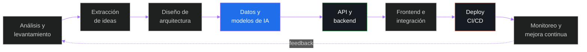

<div align="center">


<br/>


</div>

---

### `$ whoami`

```python
from dataclasses import dataclass, field

@dataclass
class AngelSalazar:
    role: str = "AI Engineer | RAG Systems | LLMOps | AI Agents"
    location: str = "Lima, Perú"
    education: list = field(default_factory=lambda: [
        "Maestría en Inteligencia Artificial — UNI",
        "Ingeniería de Sistemas — UTP (CIP 404730)",
    ])
    focus: list = field(default_factory=lambda: [
        "Evaluación y calidad de sistemas RAG",
        "LLMOps: gates, costos, observabilidad",
        "Agentes con abstención y escalamiento",
        "Seguridad de prompts (injection / jailbreak)",
    ])
    principles: list = field(default_factory=lambda: [
        "Medir antes de cambiar el modelo",
        "Citar o abstenerse — no inventar",
        "Datos sintéticos en público; cero secretos",
    ])

    def current_mission(self) -> str:
        return "Investigar, diseñar, evaluar y optimizar sistemas inteligentes."
```

---

### `$ ls flagships/`

Seis proyectos Nivel 3 (evaluación, ops, agentes, seguridad, compliance). El resto son labs satélite.

| Repo | Problema que ataca |
|---|---|
| [rag-eval-platform](https://github.com/Angelzaki/rag-eval-platform) | ¿En qué etapa se rompe el RAG cuando crece el corpus? |
| [llm-ci-gates](https://github.com/Angelzaki/llm-ci-gates) | ¿Cómo bloquear regresiones de IA en el merge? |
| [knowledge-ops-console](https://github.com/Angelzaki/knowledge-ops-console) | Ingesta → ask con citas → gold eval en una consola |
| [support-copilot-lab](https://github.com/Angelzaki/support-copilot-lab) | Responder con evidencia o escalar a humano |
| [prompt-firewall](https://github.com/Angelzaki/prompt-firewall) | Injection / jailbreak antes del LLM |
| [doc-compliance-local](https://github.com/Angelzaki/doc-compliance-local) | Checklist vs docs: evidencia, score y brechas |

```text
rag-eval ──metrics JSON──▶ llm-ci-gates (PASS/FAIL)
prompt-firewall ──valida input──▶ knowledge-ops / support-copilot
```

---

### `$ ./pipeline.sh --end-to-end`

Me encargo del ciclo completo de un producto con IA, no solo de una parte.



| Etapa | Qué hago |
|---|---|
| **Análisis** | Entender el problema, los usuarios y los datos disponibles |
| **Ideas** | Convertir necesidades en requerimientos y casos de uso con IA |
| **Diseño** | Definir arquitectura (Clean Architecture, microservicios, SOA) |
| **Modelos** | Diseñar, entrenar y evaluar modelos de Deep Learning y GenAI |
| **API** | Exponer los modelos como servicios (FastAPI, Node.js, .NET) |
| **Integración** | Conectar frontend, bases de datos, colas, WebSockets y automatizaciones |
| **Deploy** | Contenedores con Docker, cloud y pipelines de entrega |
| **Operación** | Monitorear, medir y mejorar el sistema en producción |

---

### `$ pip list --stack`

<div align="center">


</div>

---

### `$ cat model_card.md`

| | |
|---|---|
| **Model** | Angel Salazar v2026 |
| **Type** | Ingeniero de IA, arquitectura Full Stack |
| **Trained on** | Salud, educación, comercio y mucho código |
| **Strengths** | De prototipo de IA a producto desplegado |
| **Inference** | Español nativo, inglés técnico |
| **Limitations** | Depende de café; se distrae con una buena arquitectura |
| **License** | Open to collaboration |

---

### `$ git log --stats`

<div align="center">


</div>

---

### `$ ping angel`

<div align="center">

[](https://www.linkedin.com/in/angel-salazar-maylle-36236b198/)
[](https://portafolioangel-mu.vercel.app/)
[](mailto:angel.salazarmaylle@gmail.com)

<br/>


</div>
